# 💳 Awesome Hosted Checkout & Payment Pages ⚡

  <strong>Curated Directory of Top SaaS Platforms, Merchant-of-Record (MoR) Services &amp; Self-Hosted Open-Source Checkout Infrastructure</strong>

  
  
  
  
  
  

  <em>Last updated: March 2026 • Curated for fintech developers, indie hackers, SaaS founders, and e-commerce merchants.</em>

---

## 📖 Overview

This repository tracks notable **SaaS platforms** and **open-source projects** for **Hosted Checkout & Payment Pages**. These solutions provide pre-built, PCI-compliant payment interfaces that merchants can redirect customers to—covering everything from Stripe's industry-standard Checkout and Shopify's high-conversion checkout flows to open-source payment switches like Hyperswitch and Open Payment Host that eliminate platform commissions and grant full data sovereignty.

Whether you need a quick **Merchant of Record (MoR)**, a **low-code hosted redirect page**, **embedded PCI fields**, or **self-hosted Docker/Rust payment switches**, this list covers pricing structures, free tier limits, company scale, and GitHub community metrics.

Contributions are warmly welcomed! Please open a Pull Request (PR) to add or update entries.

---

## 📑 Table of Contents

- [📊 Sector Overview & Market Dynamics](#-sector-overview--market-dynamics)
- [☁️ SaaS & Hosted Payment Platforms](#️-saas--hosted-payment-platforms)
- [🛠️ Open-Source GitHub Projects](#️-open-source-github-projects)
- [🤝 How to Contribute](#-how-to-contribute)
- [⚠️ Disclaimer](#️-disclaimer)
- [⭐ Star History](#-star-history)
- [💖 Support](#-support)

---

## 📊 Sector Overview & Market Dynamics

The global payment gateway and checkout infrastructure market is estimated at **$29 billion to over $65 billion**, expanding at a compound annual growth rate (CAGR) of roughly 15% to 22% toward hundreds of billions over the next decade. The sector is **moderately to highly fragmented**: while mega-processors (Stripe, Adyen, PayPal/Braintree, Shopify) capture significant enterprise transaction volumes, deep fragmentation persists due to localized payment preferences (such as UPI, Pix, and iDEAL), varying regional acquiring regulations, and the coexistence of managed hosted checkout redirect pages versus self-hosted, composable checkout architectures.

---

## ☁️ SaaS & Hosted Payment Platforms

| Product | 🏢 Company Size (Valuation / Market Cap) | 💵 Starting Pricing Tier | 🎁 Free Tier & Trial Limits | 📝 Description |
|---|---|---|---|---|
| **[Shopify Checkout](https://www.shopify.com/)** | ~$185B Market Cap | $29/mo (Basic plan) + 2.9% + 30¢ per transaction | 3-day free trial; full store and checkout testing enabled without upfront credit card (live store processing requires paid tier or $1/mo 3-month promotional plan) | **Fully managed checkout tied to Shopify stores.** Basic: $29/mo + 2.9% + 30¢; Advanced: $299/mo + 2.5% + 30¢. Third-party gateways add 0.6%–2% extra fee unless using Shopify Payments. |
| **[Stripe Checkout](https://stripe.com/payments/checkout)** | $159B Valuation | 2.9% + 30¢ per successful card charge | Free forever plan with no monthly fee; pay-per-transaction only (2.9% + 30¢); unlimited sandbox testing environment with virtual cards | **The benchmark for hosted checkout.** Pre-built, PCI-compliant payment page supporting cards, wallets, and 40+ local payment methods. Optional Stripe Billing adds 0.7%, Tax adds 0.5%, international cards add 1.5%. |
| **[Square Online Checkout](https://squareup.com/)** | ~$51B Market Cap (Block) | 2.8% + 30¢ per transaction (Free Plan) | Free forever plan with no monthly fee and unlimited checkout links / payments (2.8% + 30¢ per transaction); paid tiers start with Plus at $36/mo | **Simple hosted checkout with a free plan.** Free plan: 2.8% + 30¢ per transaction with no recurring monthly fee. Plus: $36/mo (2.6% + 30¢); Premium: $99/mo (2.5% + 30¢). Includes store builder and buy-button embeds. |
| **[PayPal Checkout](https://www.paypal.com/)** | ~$49B Market Cap | 2.99% + 49¢ per standard card transaction; 3.49% + 49¢ for PayPal wallet transactions | Free forever plan with $0 monthly fee and unlimited transactions; pay-per-transaction only; unlimited developer sandbox testing accounts | **Highest consumer brand recognition globally.** Card payments: 2.99% + 49¢; PayPal wallet checkout: 3.49% + 49¢. Optional Recurring Billing is $10/mo. Currency conversion spread: 3–4%. |
| **[Adyen Hosted Checkout](https://www.adyen.com/)** | ~$30B Market Cap | Interchange++ pricing + €0.10–€0.12 fixed authorization fee per transaction + €120/mo platform fee | Free unlimited test account sandbox environment (simulated transactions, no dollar volume caps or request expiry); production requires sales contract with €120/mo baseline minimum | **Enterprise-grade global payment infrastructure.** Interchange-plus pricing model tailored for high-ticket and international volume. Over 250 payment methods and local acquirers unified into a PCI DSS Level 1 hosted flow. |
| **[Braintree Hosted Fields](https://www.braintreepayments.com/)** | Subsidiary of PayPal (~$49B Market Cap) | 2.89% + 29¢ per transaction (or 2.9% + 30¢ standard) | Free forever account with $0 monthly gateway/setup fees (pay-per-transaction only); fully featured sandbox with virtual credentials and 1 to 365-day test subscription trials | **Hosted fields for custom PCI-compliant checkout forms.** Secure iframes tokenize cardholder data directly from the merchant's DOM. $15 chargeback fee; international cards add 1%; non-USD settlement adds 1%. |
| **[Mollie Checkout](https://www.mollie.com/)** | $6.5B Valuation | 1.8% + €0.25 per transaction (standard EEA consumer cards); €0.29 for iDEAL | Free forever account with $0 setup fee, $0 monthly fee, and no lock-in contracts; free unlimited test mode for developers; Startup Program offers fee exemption up to €1,000,000 volume for eligible startups | **European payment provider with transparent pay-as-you-go pricing.** Pre-built, customizable hosted checkout supporting iDEAL, Bancontact, SEPA, Klarna, and global credit cards. Volume pricing available for >€50K/month. |
| **[Chargebee Checkout](https://www.chargebee.com/)** | $3.5B Valuation | $299/mo (Performance Plan, includes $100K/mo billing volume + 0.75% overage) | Free forever Starter Plan for early-stage startups until reaching $250,000 in cumulative lifetime billing volume (0.75% overage fee applies thereafter); includes hosted checkout and billing | **Subscription billing engine with hosted checkout pages.** Integrates with Stripe, Braintree, PayPal, and regional gateways to handle recurring checkouts, tax compliance, coupons, and dunning flows. |
| **[Bold Checkout (Subscriptions)](https://www.boldcommerce.com/)** | ~$150M Valuation ($44M Raised) | $24.99/mo + 2% transaction fee (Launch plan) | 30-day free trial on paid subscription tiers with full checkout customization (standard transaction fees apply on orders processed); 14-day free trial on custom pricing apps | **Subscription and modular checkout engine for Shopify and headless commerce.** Launch: $24.99/mo + 2%; Grow: $49.99/mo + 1%; Scale: $74.99/mo + 0.9%; Ultimate: $399/mo + 0.9%. |

---

## 🛠️ Open-Source GitHub Projects

| 📦 Project | 🌟 Stars_Badge | 📝 Description |
|---|---|---|
| **[Hyperswitch](https://github.com/juspay/hyperswitch)** |  | **Open-source, high-performance financial switch & hosted payment orchestration.** Written in Rust, it provides a universal PCI-compliant checkout layer and unified payment page that connects to dozens of payment processors, smart card routing, and automated reconciliation. |
| **[BTCPay Server](https://github.com/btcpayserver/btcpayserver)** |  | **Free, self-hosted, open-source cryptocurrency payment processor & checkout system.** Provides pre-built hosted invoice and checkout pages for Bitcoin (on-chain and Lightning Network) with zero fees, no third-party custody, and direct wallet settlements. |
| **[Kill Bill](https://github.com/killbill/killbill)** |  | **Open-source enterprise subscription billing and payments platform.** Provides modular invoice generation, payment gateway routing, and self-hosted subscription checkout management with support for custom payment plugins and multiple gateways. |
| **[YouPI-PG](https://github.com/youpi-pg/YouPI-PG)** |  | **Self-hosted payment gateway and checkout interface with zero platform fees.** Features universal JavaScript checkout integration, dynamic QR payments, automated payment verification, and cash-on-delivery handling. |
| **[Stripe Checkout Samples](https://github.com/stripe-samples/checkout-one-time-payments)** |  | **Official production reference implementation for Stripe Hosted Checkout.** Complete full-stack implementations across Node.js, Python, Ruby, PHP, and Go demonstrating secure session creation, redirect flows, customer portal integration, and webhook fulfillment. |
| **[Open Payment Host](https://github.com/abishekmuthian/open-payment-host)** |  | **Lightweight self-hosted alternative to Gumroad, Buy Me a Coffee, and Ko-fi.** Built with Go and Docker Compose. Provides ready-to-use checkout APIs (`/checkout/create`), subscription logic, and bring-your-own PSP processing to avoid marketplace commissions. |
| **[BigCommerce Checkout JS](https://github.com/bigcommerce/checkout-js)** |  | **BigCommerce's open-source Optimized One-Page Checkout frontend.** A modular, production-ready checkout UI written in TypeScript and React designed for headless commerce integrations, custom checkout flows, and payment gateway extensions. |
| **[Commerce Layer Hosted Checkout](https://github.com/commercelayer/mfe-checkout)** |  | **Open-source hosted checkout micro-frontend application.** Built with React and TypeScript by Commerce Layer. Handles complete multi-currency cart totals, customer address tokens, shipping selection, and integrated payment gateways out of the box. |

---

## 🤝 How to Contribute

We love community contributions! To add a new platform or update existing details:

1. 🍴 **Fork** this repository.
2. 🌿 **Create a branch** for your feature or fix (`git checkout -b feature/add-new-checkout-tool`).
3. ✏️ **Edit** `README.md` following the exact table structure:
   - For **SaaS**: Name, official link, valuation/market cap, starting price, exact free tier / trial limits, and description.
   - For **Open-Source**: Name, GitHub repo link, social Stars_Badge linking to `/stargazers`, and descriptive overview.
4. 🚀 **Submit a Pull Request (PR)** with a concise summary of why the tool is relevant.

---

## ⚠️ Disclaimer

- This repository is a **community-curated guide** intended for informational and educational purposes. It does not constitute financial, legal, or payment processing endorsement.
- Hosted checkout platforms handle payment card data and customer PII; **PCI DSS compliance is mandatory**. Using a fully hosted checkout page (e.g., Stripe, PayPal, Square, Shopify) transfers the bulk of the PCI burden to the provider under SAQ-A, while self-hosted solutions require independent compliance validation.
- **Hosted checkout fees compound in ways headline rates hide**:
  - **Stripe**: The standard 2.9% + 30¢ base rate increases with Stripe Billing (+0.7%), Stripe Tax (+0.5%), international cards (+1.5%), and currency conversion (+1%), pushing effective rates towards 5%–6% for cross-border subscription businesses.
  - **PayPal**: Wallet rates stand at 3.49% + 49¢ plus 3%–4% currency conversion spread on international checkouts.
  - **Shopify**: Non-Shopify Payments transactions incur a 0.6%–2% third-party gateway fee penalty.
  - **Square**: Features an accessible $0/month free plan at 2.8% + 30¢ per checkout transaction.
  - **Open-source solutions**: Eliminate platform commissions completely, but transfer infrastructure maintenance, server costs, and uptime reliability to your engineering team.

---

## 📈 Star History

---

## 💖 Support

If you found this curated list helpful for your payment infrastructure research, consider supporting the project:

- ⭐ **Star** this repository to help others discover it!
- 🍴 **Fork** and contribute new tools or updates.
- 📢 **Share** with fellow engineers, founders, and developers on social platforms.
- ☕ **Sponsor / Buy Me a Coffee**: If you'd like to back maintenance and new open-source resources, visit the [GitHub Sponsors Dashboard](https://github.com/sponsors/ishandutta2007).

Thank you for being part of the open-source payment ecosystem! 🙌
